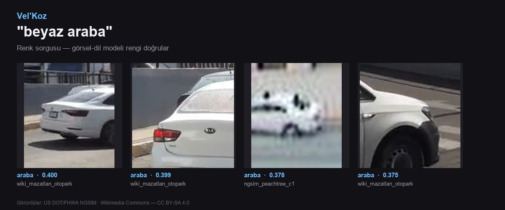
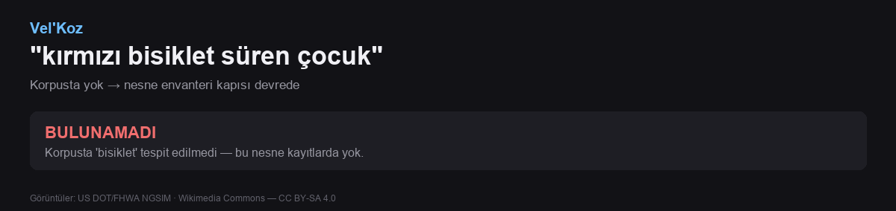
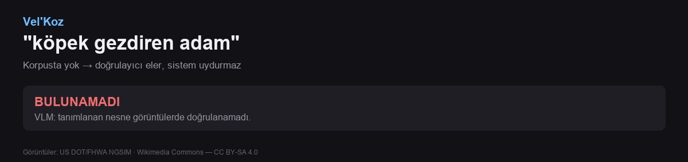
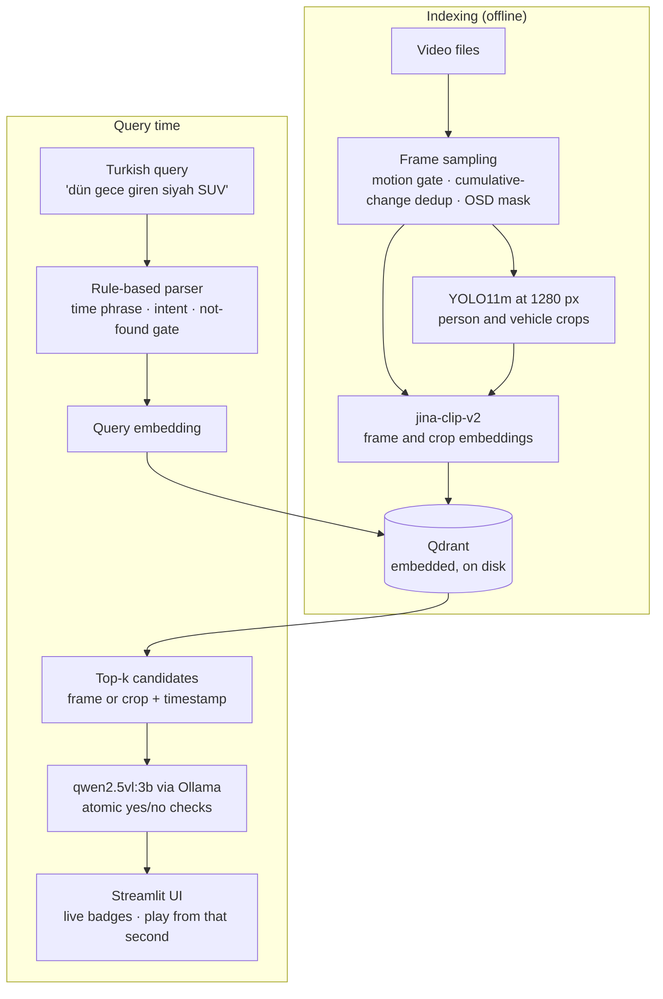

# Vel'Koz

*[Türkçe](README.tr.md)*

**Search a security-camera archive by typing what you are looking for, in Turkish.**
Vel'Koz indexes recorded video, takes a query such as *"kırmızı kıyafetli adam"* ("a man in red
clothing"), returns the matching moments with timestamps and plays the video from that second.
It runs on a single mid-range GPU, loads its models from the local cache, and keeps every
frame, embedding and query on the machine.

It is built for the person who has to find the moment something happened in hours of
recordings: a site manager, a car-park operator, a security officer.

<p align="center">
  
</p>
<p align="center"><sub>Query <code>beyaz araba</code> ("white car"). Candidates come from CLIP retrieval; the colour is
then confirmed by a vision-language model. Demo footage: US DOT/FHWA NGSIM and Wikimedia Commons, CC BY-SA 4.0.</sub></p>

> The Python package and the command line are named `gozcu` (Turkish for "watchman").

## What you can ask

Queries stay in Turkish; the system embeds them directly, with no translation step.

| Query | Meaning | What it exercises |
|---|---|---|
| `dün gece otoparka giren siyah SUV` | black SUV entering the car park last night | the time phrase becomes a timestamp filter and only the visual part is embedded |
| `telefonla konuşan sürücü` | driver talking on the phone | behaviour, not just an object class |
| `uzakta tek başına yürüyen insan` | a person walking alone in the distance | small subjects, found through per-object crops |
| `araçlarla dolu açık otopark` | an open car park full of vehicles | Turkish case suffixes tell a scene query from an object query |
| `kırmızı kıyafetli adam` | a man in red clothing | the verifier asks "is this man wearing red?", not "is this red?" |
| `kırmızı bisiklet süren çocuk` | a child riding a red bicycle | nothing like it in the archive, so the answer is "not found" |

## It says "not found" instead of guessing

A similarity search always returns *something*. Vel'Koz has two separate checks that let it
return nothing when the archive does not contain what was asked for.

**1. Object inventory gate.** If the query names an object class the detector has never seen
in this archive, the search returns empty before CLIP is consulted:

<p align="center"></p>

**2. Vision-language verifier.** If the object class exists but the description does not
match, a local VLM rejects the candidates one by one:

<p align="center"></p>

<sub>"BULUNAMADI" means "not found". The second message reads "VLM: the described object could not be verified in the images."</sub>

## How it works



- **Turkish without translation.** `jinaai/jina-clip-v2` (1024-d, multilingual) embeds the
  Turkish query straight into the image space ([`gozcu/embedder.py`](gozcu/embedder.py)).
- **Small subjects get their own vectors.** A distant person in a wide 1080p shot is a few
  dozen pixels and disappears in a whole-frame embedding. YOLO11m at 1280 px detects people
  and vehicles and each crop is indexed as a separate vector next to its frame
  ([`gozcu/detector.py`](gozcu/detector.py)).
- **The sampler was rebuilt after measuring it.** The first design deduplicated frames with
  a perceptual hash, which proved blind to a walking person three pixels tall. It now keeps
  frames by accumulated, noise-filtered change, masks burnt-in DVR clocks and caps frames
  per camera-hour ([`gozcu/sampler.py`](gozcu/sampler.py),
  [`experiments/2026-07-03_gercek_cctv_testi/`](experiments/2026-07-03_gercek_cctv_testi/deney_notu.md)).
- **Turkish morphology decides intent.** In *araçlar**la** dolu otopark* the case suffix marks
  "vehicles" as an adjunct, so the head noun "car park" makes it a scene query, and whole
  frames get a soft boost over the flood of vehicle crops. Root matching also checks that what
  follows a root is a valid suffix chain, so *karanlık* ("dark") no longer matches *kar*
  ("snow") ([`gozcu/query.py`](gozcu/query.py)).
- **A small VLM, used where it is reliable.** Asked to fill a multi-field JSON verdict,
  `qwen2.5vl:3b` approved a red car as "blue car" 9 times out of 9. Asked a plain yes/no
  question it answered correctly 9/9 for red and 0/9 for blue. The verifier therefore splits
  the query into atomic questions such as *"Is there a car?"* and *"Is the car red?"*
  ([`gozcu/verifier.py`](gozcu/verifier.py),
  [`experiments/2026-07-05_vlm_latency/deney_notu.md`](experiments/2026-07-05_vlm_latency/deney_notu.md)).
- **No waiting for the VLM.** CLIP results appear first; a worker thread verifies the
  candidates one by one and each card's badge updates as its verdict arrives
  ([`gozcu/search.py`](gozcu/search.py), [`gozcu/viewer.py`](gozcu/viewer.py)).

Every design decision, with the measurement behind it and what was tried and rejected, is in
**[ARCHITECTURE.md](ARCHITECTURE.md)**.

## Measured results

The evaluation set is 22 Turkish queries, frozen before any results were seen
([`eval/queries_c2.yaml`](eval/queries_c2.yaml), runner [`eval/run_eval.py`](eval/run_eval.py)).
The corpus has 17 research videos from MEVA, VIRAT and UCF (6,231 vectors: 1,114 frames and
5,117 object crops). Latest run: [`experiments/2026-08-04_cevrimdisi_sertlestirme/rapor.md`](experiments/2026-08-04_cevrimdisi_sertlestirme/rapor.md).

| Retrieval (12 scorable queries) | Value | Wilson 95% CI |
|---|---|---|
| Recall@1 | 0.833 | 0.552 to 0.953 |
| Recall@5 | 0.917 | 0.646 to 0.985 |
| Recall@10 | 1.000 | 0.757 to 1.000 |
| MRR | 0.889 | |

| Other checks | Result | Source |
|---|---|---|
| Value of crop embeddings | Recall@5 0.667 with frames only, 0.917 with frames and crops (+0.250) | same report |
| Not-found gate | 4 of 4 absent-object queries returned empty; no positive query was blocked | same report |
| End-to-end with VLM | 11 of 12 expectations met; 2 of 2 on the "person query must not return vehicles" check | [`faz2_eval_sonuc.json`](experiments/2026-08-04_cevrimdisi_sertlestirme/faz2_eval_sonuc.json) |
| Query embedding latency | 286 ms on GPU (warm), about 13 s on CPU | [PROGRESS.md](PROGRESS.md), 5 July 2026 entry |

**Read these numbers with their size in mind.** Twelve scorable queries make an indicator and
a regression baseline, not a benchmark: the confidence intervals above are wide. The method
compensates where it can. Every change is compared on the same frozen set, label types get
their own metric (video-level recall, eye-checked golden frames, advisory-only colour), and
when the corpus grew the ground truth was extended by a written protocol instead of being
edited to rescue a metric ([ARCHITECTURE.md §6b–6d](ARCHITECTURE.md#6b-evaluation-methodology-4-july-2026)).
One weakness the reports keep visible: golden-frame Recall@1 is 0.667 on n=3.

The evaluation corpus is research-licensed and cannot be redistributed, so reproducing these
numbers requires obtaining MEVA, VIRAT and UCF yourself. The repository holds the code, the
query sets and the result files.

## Quick start

Requirements: Python 3.12, an NVIDIA GPU (developed on an 8 GB RTX 4070 Laptop; CPU works but
is much slower), and optionally [Ollama](https://ollama.com/download) for the VLM verifier.
The setup commands are written for Windows; on Linux/macOS activate the venv with
`source .venv/bin/activate`.

```bash
git clone https://github.com/SelmanBoray/velkoz.git && cd velkoz
python -m venv .venv && .venv\Scripts\activate

# 1) torch first, from the CUDA index. The default PyPI wheel on Windows is CPU-only:
#    everything still runs, just much slower, and nothing warns you.
pip install torch torchvision --index-url https://download.pytorch.org/whl/cu126

# 2) the rest (transformers is pinned below 4.50 for jina-clip-v2)
pip install -r requirements.txt

# 3) YOLO weights into the repo root (automatic download is disabled on purpose)
python -c "from ultralytics import YOLO; YOLO('yolo11m.pt')"

# 4) optional: the VLM verifier, needed for colour and negation queries (~3.2 GB)
ollama pull qwen2.5vl:3b

# 5) check the installation; each failing component prints the command that fixes it
python -m gozcu doctor
```

Then:

```bash
python -m gozcu index <video_folder>                          # first run downloads jina-clip-v2 (~1.7 GB)
python -m gozcu search "dün gece otoparka giren siyah SUV"
python -m gozcu ui                                            # Streamlit UI at http://localhost:8501
```

Without Ollama the system runs CLIP-only and the UI says so. The CLI and UI text is Turkish.

## Local by design

Camera footage is personal data under Turkey's data-protection law (KVKK), so nothing goes to
a cloud service. This is enforced in code, not just stated:

- Once jina-clip-v2 is cached, `HF_HUB_OFFLINE=1` is set before transformers is imported,
  which stops the per-start check against Hugging Face ([`gozcu/config.py`](gozcu/config.py)).
- The YOLO weight is loaded from a fixed path; if it is missing the program stops with an
  error instead of downloading it silently ([`gozcu/detector.py`](gozcu/detector.py)).
- The VLM is reached only through Ollama on `localhost`.
- With all outbound traffic blocked, indexing, search and the not-found gate were tested end
  to end ([PROGRESS.md](PROGRESS.md), 4–5 August 2026 entries). `doctor` reports whether the
  offline lock is active.

One thing the code does not yet switch off: Streamlit's own anonymous usage statistics. For a
fully silent deployment, set `browser.gatherUsageStats = false` in Streamlit's `config.toml`.

## Portable package

[`scripts/paket_hazirla.py`](scripts/paket_hazirla.py) builds a Windows folder that runs
without Python, pip, internet access or admin rights: the venv, the model cache, the code and
the YOLO weight, plus `basla.bat` (start the UI) and `denetle.bat` (run `doctor`). The
generated package was 6.59 GB and was tested end to end from inside the folder with the
network blocked ([PROGRESS.md](PROGRESS.md)). Ollama is left out to keep the package smaller
and simpler; the script header explains why PyInstaller and Inno Setup were rejected.

```bash
python scripts/paket_hazirla.py --dry-run                  # size report only
python scripts/paket_hazirla.py --hedef D:/velkoz_paket    # build the folder (--zip to compress)
```

## Limitations

- **Small evaluation set** (see above), and no field pilot yet: everything is measured on
  public research footage, not on a customer's week of recordings.
- **Timestamps come from file modification time** minus video duration. Real DVR exports can
  lie about this; cross-checking with the on-screen clock (OCR) is planned, not built.
- **No identity tracking.** The UI groups hits into "seen between 21:26:07 and 21:28:18" by
  time proximity and says that it does. It does not claim "entered" or "left".
- **People below roughly 10 px** fall under YOLO's detection floor.
- **VLM verification is slow**: a few seconds per candidate, tens of seconds for a full page.
  Streaming hides it but does not remove it.
- **Suffix checking is not full morphology**: *kara* can still read as *kar* + dative *-a*.
  A morphological analyser would fix it.
- **The demo clips are not real CCTV.** Openly licensed, redistributable surveillance-angle
  footage turned out to be almost nonexistent; see
  [`docs/DEMO_KORPUS_LISANS.md`](docs/DEMO_KORPUS_LISANS.md).

## Status

| Phase | Scope | State |
|---|---|---|
| 1 | Video to searchable index, Turkish query, frame and timestamp | done |
| 1.5 | Separate vectors for person and vehicle crops | done |
| 2 | VLM verification: colour, negation, not-found | done |
| 3 | Field pilot on one site's week of recordings | next |
| later | Vehicle tracking and plates, for "when did it enter and leave" | planned |

## Licensing

No license has been chosen for this repository yet. Note the licenses of the models it runs:
`jina-clip-v2` is CC BY-NC 4.0, `qwen2.5vl:3b` is under the Qwen Research license (both
non-commercial), and Ultralytics YOLO11 is AGPL-3.0. A commercial deployment would need
commercial licenses or replacement models. Replacing the VLM was measured: `qwen3-vl:2b`
dropped the end-to-end score from 11/12 to 9/12, so it was rejected
([`docs/LISANS_DURUMU.md`](docs/LISANS_DURUMU.md), in Turkish).

The measurement corpus (MEVA, VIRAT, UCF) is research-licensed and is not in this repository.
The demo images in `docs/demo/` come from US DOT/FHWA NGSIM and Wikimedia Commons under
CC BY-SA 4.0; full attribution is in [`docs/DEMO_KORPUS_LISANS.md`](docs/DEMO_KORPUS_LISANS.md).

## Repository layout

```
gozcu/         the package: sampler, detector, embedder, store, query parser, search, verifier, UI, CLI
eval/          frozen query sets and the evaluation runners
experiments/   one folder per experiment: notes, reports, result JSON (no images or video)
scripts/       demo-card generator and portable-package builder
docs/          demo images, licensing notes and other project documents (Turkish)
```

Most comments and project notes are in Turkish; [ARCHITECTURE.md](ARCHITECTURE.md) is the
English entry point to the design.
