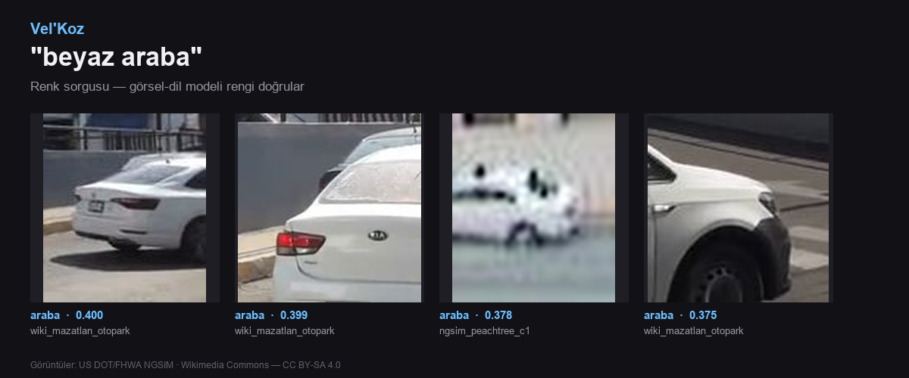
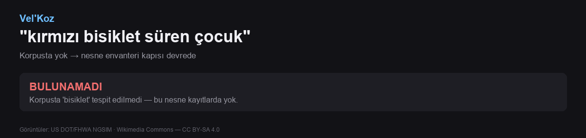
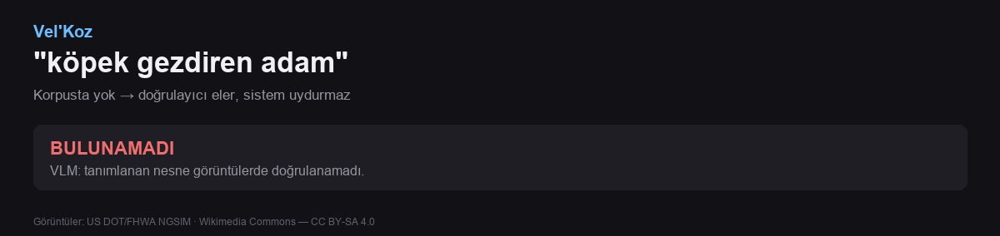
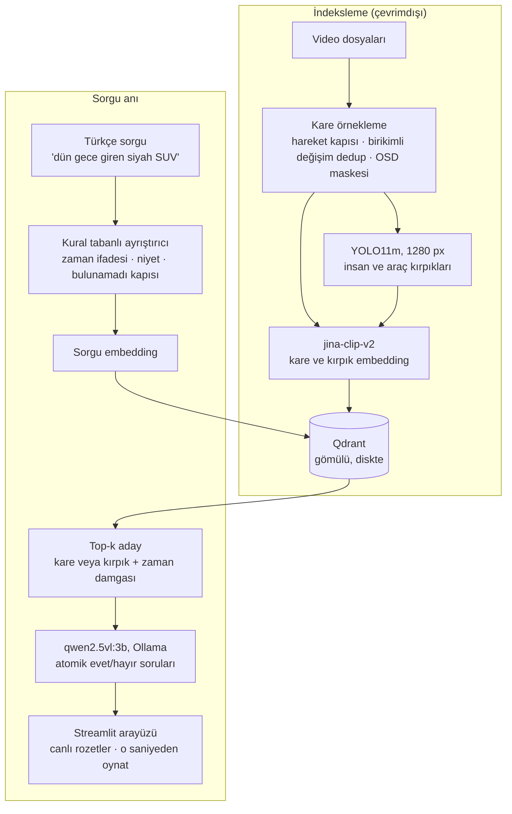

# Vel'Koz

*[English](README.md)*

**Güvenlik kamerası arşivinde aradığını Türkçe yazarak bul.**
Vel'Koz kayıtlı videoyu indeksler, *"kırmızı kıyafetli adam"* gibi bir sorguyu alır, eşleşen
anları zaman damgasıyla getirir ve videoyu o saniyeden oynatır. Tek bir orta seviye GPU'da
çalışır, modelleri yerel önbellekten yükler; hiçbir kare, embedding veya sorgu makineden çıkmaz.

Saatlerce kayıt içinde bir olayın anını bulmak zorunda kalan kişi için yapıldı: site yöneticisi,
otopark işletmecisi, güvenlik görevlisi.

<p align="center">
  
</p>
<p align="center"><sub><code>beyaz araba</code> sorgusu. Adaylar CLIP aramasından gelir; renk ardından bir görsel-dil
modeliyle doğrulanır. Demo görüntüleri: US DOT/FHWA NGSIM ve Wikimedia Commons, CC BY-SA 4.0.</sub></p>

## Neler sorulabilir

Sorgular Türkçe kalır; sistem onları çeviri katmanı olmadan doğrudan gömer.

| Sorgu | Neyi sınar |
|---|---|
| `dün gece otoparka giren siyah SUV` | zaman ifadesi zaman damgası filtresine dönüşür, yalnız görsel kısım embedlenir |
| `telefonla konuşan sürücü` | yalnız nesne sınıfı değil, davranış |
| `uzakta tek başına yürüyen insan` | küçük özneler, nesne kırpıklarının ayrı vektörleri sayesinde |
| `araçlarla dolu açık otopark` | Türkçe hâl ekleri sahne sorgusunu nesne sorgusundan ayırır |
| `kırmızı kıyafetli adam` | doğrulayıcı "bu kırmızı mı?" değil "bu adam kırmızı giymiş mi?" diye sorar |
| `kırmızı bisiklet süren çocuk` | arşivde böyle bir şey yok, cevap "bulunamadı" |

## Tahmin etmek yerine "bulunamadı" der

Benzerlik araması her zaman *bir şey* döndürür. Vel'Koz'da, arşivde aranan şey yoksa boş dönmesini
sağlayan iki ayrı kontrol var.

**1. Nesne envanteri kapısı.** Sorgu, dedektörün bu arşivde hiç görmediği bir nesne sınıfı
istiyorsa arama CLIP'e sorulmadan boş döner:

<p align="center"></p>

**2. Görsel-dil doğrulayıcı.** Nesne sınıfı arşivde var ama tarif tutmuyorsa yerel bir VLM
adayları tek tek eler:

<p align="center"></p>

## Nasıl çalışır



- **Çevirisiz Türkçe.** `jinaai/jina-clip-v2` (1024 boyut, çok dilli) Türkçe sorguyu doğrudan
  görüntü uzayına gömer ([`velkoz/embedder.py`](velkoz/embedder.py)).
- **Küçük öznelere ayrı vektör.** 1080p geniş planda uzaktaki bir insan birkaç düzine pikseldir
  ve tam-kare embedding'de kaybolur. YOLO11m 1280 px'te insan ve araçları tespit eder; her kırpık
  karesinin yanında ayrı bir vektör olarak indekslenir ([`velkoz/detector.py`](velkoz/detector.py)).
- **Örnekleyici ölçüldükten sonra yeniden yazıldı.** İlk tasarım kareleri algısal hash ile
  tekilleştiriyordu; üç piksel boyundaki yürüyen insana kör çıktı. Artık kareler birikimli,
  gürültüsü süzülmüş değişime göre tutuluyor, yanık DVR saati maskeleniyor ve kamera-saat başına
  kare sayısı sınırlanıyor ([`velkoz/sampler.py`](velkoz/sampler.py),
  [`experiments/2026-07-03_gercek_cctv_testi/`](experiments/2026-07-03_gercek_cctv_testi/deney_notu.md)).
- **Niyeti Türkçe morfoloji belirler.** *araçlar**la** dolu otopark* sorgusunda hâl eki "araçlar"ı
  tümleç yapar; baş isim "otopark" olduğu için sorgu sahne sorgusudur ve tam kareler araç
  kırpıklarının selinden yumuşak bir öne çekmeyle korunur. Kök eşleşmesi kökten sonra gelen
  parçanın geçerli bir ek dizisi olduğunu da denetler; böylece *karanlık* artık *kar* olarak
  okunmuyor ([`velkoz/query.py`](velkoz/query.py)).
- **Küçük VLM, güvenilir olduğu yerde.** Çok alanlı bir JSON kararı doldurması istendiğinde
  `qwen2.5vl:3b` kırmızı bir arabayı 9'da 9 "mavi araba" diye onayladı. Düz evet/hayır sorusunda
  ise kırmızıya 9/9, maviye 0/9 doğru cevap verdi. Bu yüzden doğrulayıcı sorguyu *"Is there a car?"*
  ve *"Is the car red?"* gibi atomik sorulara böler ([`velkoz/verifier.py`](velkoz/verifier.py),
  [`experiments/2026-07-05_vlm_latency/deney_notu.md`](experiments/2026-07-05_vlm_latency/deney_notu.md)).
- **VLM beklenmez.** Önce CLIP sonuçları görünür; bir işçi thread adayları sırayla doğrular ve
  her kartın rozeti kararı geldikçe güncellenir ([`velkoz/search.py`](velkoz/search.py),
  [`velkoz/viewer.py`](velkoz/viewer.py)).

Her tasarım kararı, arkasındaki ölçüm, denenip reddedilenlerle birlikte
**[ARCHITECTURE.md](ARCHITECTURE.md)** dosyasında (İngilizce). Proje günlüğü:
**[PROGRESS.md](PROGRESS.md)**.

## Ölçülen sonuçlar

Değerlendirme seti, hiçbir sonuca bakılmadan dondurulmuş 22 Türkçe sorgudan oluşur
([`eval/queries_c2.yaml`](eval/queries_c2.yaml), koşucu [`eval/run_eval.py`](eval/run_eval.py)).
Korpus MEVA, VIRAT ve UCF'den 17 araştırma videosu (6.231 vektör: 1.114 kare ve 5.117 nesne
kırpığı). Son koşu: [`experiments/2026-08-04_cevrimdisi_sertlestirme/rapor.md`](experiments/2026-08-04_cevrimdisi_sertlestirme/rapor.md).

| Erişim (12 skorlanabilir sorgu) | Değer | Wilson %95 GA |
|---|---|---|
| Recall@1 | 0.833 | 0.552 – 0.953 |
| Recall@5 | 0.917 | 0.646 – 0.985 |
| Recall@10 | 1.000 | 0.757 – 1.000 |
| MRR | 0.889 | |

| Diğer kontroller | Sonuç | Kaynak |
|---|---|---|
| Kırpık embedding'in katkısı | Yalnız kareyle Recall@5 0.667, kare + kırpıkla 0.917 (+0.250) | aynı rapor |
| Bulunamadı kapısı | Arşivde olmayan nesneyi soran 4 sorgunun 4'ü boş döndü; hiçbir pozitif sorgu takılmadı | aynı rapor |
| VLM ile uçtan uca | 12 beklentiden 11'i tuttu; "kişi sorgusu araç getirmemeli" kontrolünde 2/2 | [`faz2_eval_sonuc.json`](experiments/2026-08-04_cevrimdisi_sertlestirme/faz2_eval_sonuc.json) |
| Sorgu embedding gecikmesi | GPU'da 286 ms (ısınmış), CPU'da yaklaşık 13 sn | [PROGRESS.md](PROGRESS.md), 5 Temmuz 2026 kaydı |

**Bu sayıları büyüklükleriyle birlikte okuyun.** On iki skorlanabilir sorgu bir gösterge ve
regresyon temelidir, benchmark değildir; yukarıdaki güven aralıkları geniştir. Yöntem bunu
elinden geldiğince telafi eder: her değişiklik aynı dondurulmuş sette karşılaştırılır, her etiket
tipinin kendi metriği vardır (video düzeyinde recall, gözle doğrulanmış golden-frame, yalnız
denetim amaçlı renk) ve korpus büyüdüğünde ground truth bir metriği kurtarmak için oynanmadı,
yazılı bir protokolle genişletildi ([ARCHITECTURE.md §6b–6d](ARCHITECTURE.md#6b-evaluation-methodology-4-july-2026)).
Raporların açıkça gösterdiği bir zayıflık: golden-frame Recall@1 n=3'te 0.667.

Ölçüm korpusu araştırma lisanslıdır ve yeniden dağıtılamaz; bu sayıları yeniden üretmek için
MEVA, VIRAT ve UCF'yi kendiniz edinmeniz gerekir. Depoda kod, sorgu setleri ve sonuç dosyaları var.

## Hızlı başlangıç

Gereksinimler: Python 3.12, NVIDIA GPU (8 GB RTX 4070 Laptop üzerinde geliştirildi; CPU'da da
çalışır ama çok daha yavaş), VLM doğrulayıcı için isteğe bağlı [Ollama](https://ollama.com/download).
Kurulum komutları Windows için yazıldı; Linux/macOS'ta venv'i `source .venv/bin/activate` ile
etkinleştirin.

```bash
git clone https://github.com/SelmanBoray/velkoz.git && cd velkoz
python -m venv .venv && .venv\Scripts\activate

# 1) ÖNCE torch, CUDA indeksinden. Windows'ta PyPI'ın varsayılan wheel'i CPU-only gelir:
#    her şey yine çalışır, yalnızca çok daha yavaş ve hiçbir uyarı vermez.
pip install torch torchvision --index-url https://download.pytorch.org/whl/cu126

# 2) kalan bağımlılıklar (jina-clip-v2 için transformers<4.50 sabit)
pip install -r requirements.txt

# 3) YOLO ağırlığı depo köküne (otomatik indirme bilinçli olarak kapalı)
python -c "from ultralytics import YOLO; YOLO('yolo11m.pt')"

# 4) isteğe bağlı: renk ve olumsuzluk sorguları için VLM doğrulayıcı (~3.2 GB)
ollama pull qwen2.5vl:3b

# 5) kurulumu denetle; arızalı her bileşen için düzeltme komutu yazılır
python -m velkoz doctor
```

Ardından:

```bash
python -m velkoz index <video_klasörü>                        # ilk çalıştırma jina-clip-v2'yi indirir (~1.7 GB)
python -m velkoz search "dün gece otoparka giren siyah SUV"
python -m velkoz ui                                           # Streamlit arayüzü: http://localhost:8501
```

Ollama yoksa sistem yalnız CLIP ile çalışır ve arayüz bunu bildirir.

## Tasarımı gereği yerel

Kamera görüntüsü KVKK kapsamında kişisel veridir; bu yüzden hiçbir şey bir bulut servisine
gitmez. Bu yalnızca söylenmiyor, kodda zorlanıyor:

- jina-clip-v2 önbelleğe girdikten sonra `HF_HUB_OFFLINE=1`, transformers import edilmeden önce
  kurulur; Hugging Face'e her açılışta yapılan kontrol durur ([`velkoz/config.py`](velkoz/config.py)).
- YOLO ağırlığı sabit bir yoldan yüklenir; yoksa sessizce indirilmez, program hata verip durur
  ([`velkoz/detector.py`](velkoz/detector.py)).
- VLM'e yalnızca `localhost` üzerindeki Ollama ile ulaşılır.
- Tüm dış trafik engelliyken indeksleme, arama ve bulunamadı kapısı uçtan uca test edildi
  ([PROGRESS.md](PROGRESS.md), 4–5 Ağustos 2026 kayıtları). `doctor`, çevrimdışı kilidin etkin
  olup olmadığını raporlar.

Kodun henüz kapatmadığı bir şey var: Streamlit'in kendi anonim kullanım istatistikleri. Tamamen
sessiz bir kurulum için Streamlit'in `config.toml` dosyasında `browser.gatherUsageStats = false`
ayarlanmalı.

## Taşınabilir paket

[`scripts/paket_hazirla.py`](scripts/paket_hazirla.py), hedef makinede Python, pip, internet veya
yönetici hakkı gerektirmeden çalışan bir Windows klasörü üretir: venv, model önbelleği, kod ve
YOLO ağırlığı, ayrıca `basla.bat` (arayüzü açar) ve `denetle.bat` (`doctor` çalıştırır). Üretilen
paket 6.59 GB'tı ve ağ engelliyken klasörün içinden uçtan uca test edildi
([PROGRESS.md](PROGRESS.md)). Ollama, paketi küçük ve sade tutmak için dışarıda bırakıldı;
PyInstaller ve Inno Setup'ın neden seçilmediği betik başlığında yazılı.

```bash
python scripts/paket_hazirla.py --dry-run                  # yalnız boyut raporu
python scripts/paket_hazirla.py --hedef D:/velkoz_paket    # klasörü üret (--zip ile sıkıştır)
```

## Sınırlar

- **Değerlendirme seti küçük** (yukarıya bakın) ve henüz saha pilotu yok: her şey bir müşterinin
  bir haftalık kaydında değil, açık araştırma görüntülerinde ölçüldü.
- **Zaman damgaları dosya değişiklik zamanından** video süresi çıkarılarak hesaplanır. Gerçek DVR
  dışa aktarımları bu konuda yanıltabilir; ekrandaki saatle (OCR) çapraz kontrol planlandı, yapılmadı.
- **Kimlik takibi yok.** Arayüz eşleşmeleri zaman yakınlığına göre "21:26:07 ile 21:28:18 arası
  görüldü" diye gruplar ve bunu açıkça söyler. "Girdi" ya da "çıktı" iddia etmez.
- **Yaklaşık 10 pikselin altındaki insanlar** YOLO'nun tespit tabanının altında kalır.
- **VLM doğrulaması yavaştır**: aday başına birkaç saniye, tam bir sayfa için onlarca saniye.
  Akışlı gösterim bunu gizler ama ortadan kaldırmaz.
- **Ek denetimi tam morfoloji değildir**: *kara* hâlâ *kar* + yönelme eki *-a* olarak okunabilir.
  Bir morfolojik çözümleyici bunu çözer.
- **Demo klipleri gerçek CCTV değildir.** Açık lisanslı, yeniden dağıtılabilir, gerçek gözetim
  açılı görüntü pratikte yok denecek kadar az; bkz.
  [`docs/DEMO_KORPUS_LISANS.md`](docs/DEMO_KORPUS_LISANS.md).

## Durum

| Faz | Kapsam | Durum |
|---|---|---|
| 1 | Video → aranabilir indeks, Türkçe sorgu, kare ve zaman damgası | tamam |
| 1.5 | İnsan ve araç kırpıklarına ayrı vektör | tamam |
| 2 | VLM doğrulaması: renk, olumsuzluk, bulunamadı | tamam |
| 3 | Bir sitenin bir haftalık kaydıyla saha pilotu | sırada |
| ileri | "Ne zaman girdi, ne zaman çıktı" için araç takibi ve plaka | planlı |

## Lisans

Bu depo için henüz bir lisans seçilmedi. Çalıştırdığı modellerin lisanslarına dikkat:
`jina-clip-v2` CC BY-NC 4.0, `qwen2.5vl:3b` Qwen Research lisansı (ikisi de ticari kullanıma
kapalı), Ultralytics YOLO11 ise AGPL-3.0. Ticari bir kurulum için ticari lisans ya da model
değişimi gerekir. VLM değişimi ölçüldü: `qwen3-vl:2b` uçtan uca skoru 11/12'den 9/12'ye
düşürdüğü için reddedildi ([`docs/LISANS_DURUMU.md`](docs/LISANS_DURUMU.md)).

Ölçüm korpusu (MEVA, VIRAT, UCF) araştırma lisanslıdır ve bu depoda yer almaz. `docs/demo/`
altındaki demo görselleri US DOT/FHWA NGSIM ve Wikimedia Commons kaynaklıdır, CC BY-SA 4.0;
tam künye [`docs/DEMO_KORPUS_LISANS.md`](docs/DEMO_KORPUS_LISANS.md) dosyasında.

## Depo yapısı

```
velkoz/        paket: örnekleyici, dedektör, embedder, depo, sorgu ayrıştırıcı, arama, doğrulayıcı, arayüz, CLI
eval/          dondurulmuş sorgu setleri ve değerlendirme koşucuları
experiments/   her deney için bir klasör: notlar, raporlar, sonuç JSON'u (görüntü ve video yok)
scripts/       demo kartı üreticisi ve taşınabilir paket hazırlayıcı
docs/          demo görselleri, lisans notları ve diğer proje belgeleri
```
